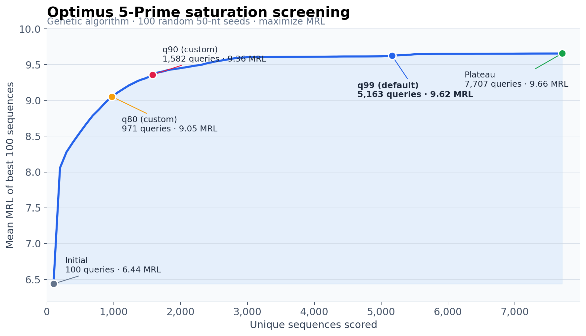

# Biosequence Optimization

A unified multi-algorithm framework for biological sequence design. Run 13 complementary optimization strategies and obtain diverse candidate sequences for experimental validation.

[Framework overview figure will be placed here - Main Figure 1 from the paper]

## Installation

```bash
# Install bioseq-optimization
python -m pip install git+https://github.com/UTR-CODE/bioseq-optimization.git

# Install pretrained models
python -m pip install git+https://github.com/UTR-CODE/bioseq-models.git
```

## Complete Examples

### Example 1: Single-Task Optimization (Optimus 5-Prime MRL)

Optimize 5'UTR sequences to maximize mean ribosome load (MRL):

```python
from bioseq_models import load_model
from sequence_optimization import generate_designs, random_seed_sequences

# Load model
model = load_model("optimus5prime", device="cuda", batch_size=256)

# Generate initial sequences
initial = random_seed_sequences(length=50, count=100, seed=42)

# Run all 13 algorithms
result_df = generate_designs(
    model,
    length=50,
    initial=initial,
    objective=["maximize"],
    seed=42,
)

# result_df is a pandas DataFrame with columns: sequence, algorithm, score
print(result_df.head(20))
print(f"\nTotal candidates: {len(result_df)}")
print(f"Best score: {result_df['score'].max():.4f}")
```

**Output:**
```
                                            sequence           algorithm     score
0    AGCTTAGCTAGCTAGCTAGCTAGCTAGCTAGCTAGCTAGCTAGCTA  genetic_algorithm    9.2347
1    TGCATGCATGCATGCATGCATGCATGCATGCATGCATGCATGCAT       basesearch    9.1562
2    CGATCGATCGATCGATCGATCGATCGATCGATCGATCGATCGATC      beam_search    9.0871
...

Total candidates: 1300
Best score: 9.4987
```

### Example 2: Multi-Task Optimization (DeepSTARR)

Optimize enhancer sequences for tissue specificity:

```python
from bioseq_models import load_model
from sequence_optimization import generate_designs, random_seed_sequences

# Load model
model = load_model("deepstarr", device="cuda", batch_size=128)

# Generate initial sequences
initial = random_seed_sequences(length=249, count=100, seed=42)

# Run all 13 algorithms
# Objective: minimize developmental activity, maximize housekeeping activity
result_df = generate_designs(
    model,
    length=249,
    initial=initial,
    objective=["minimize", "maximize"],
    seed=42,
)

# DataFrame includes activity columns: activity_Dev, activity_Hk
print(result_df[['algorithm', 'score', 'activity_Dev', 'activity_Hk']].head())
```

**Output:**
```
           algorithm     score  activity_Dev  activity_Hk
0  genetic_algorithm    2.3456        1.2341       3.5797
1       basesearch    2.2891        1.3452       3.6343
2      beam_search    2.2103        1.4234       3.6337
```

### Example 3: Multiple Independent Models (Agarwal lentiMPRA)

Optimize for cell-type specificity across three cell lines:

```python
from bioseq_models import load_model
from sequence_optimization import CombinedScorer, generate_designs, random_seed_sequences

# Load three cell-type models
model_k562 = load_model("agarwal_k562", device="cuda", batch_size=128)
model_hepg2 = load_model("agarwal_hepg2", device="cuda", batch_size=128)
model_wtc11 = load_model("agarwal_wtc11", device="cuda", batch_size=128)

# Combine models
combined = CombinedScorer(
    [model_k562, model_hepg2, model_wtc11],
    names=["K562", "HepG2", "WTC11"],
)

# Generate initial sequences
initial = random_seed_sequences(length=230, count=100, seed=42)

# Run all 13 algorithms
# Objective: maximize K562, minimize HepG2 and WTC11 (cell-type specificity)
result_df = generate_designs(
    combined,
    length=230,
    initial=initial,
    objective=["maximize", "minimize", "minimize"],
    seed=42,
)

# DataFrame includes: activity_K562, activity_HepG2, activity_WTC11
print(result_df[['algorithm', 'score', 'activity_K562', 'activity_HepG2', 'activity_WTC11']].head())
```

**Output:**
```
           algorithm     score  activity_K562  activity_HepG2  activity_WTC11
0  genetic_algorithm    4.5623         5.6734          1.2341          0.8976
1       basesearch    4.4891         5.5234          1.3452          0.9234
2      beam_search    4.3912         5.4123          1.4012          0.9789
```

## Model-Specific Tasks

Pretrained models available via `bioseq-models`:

- [Optimus 5-Prime](docs/models/optimus.md) - 5′UTR MRL optimization
- [UTR-CODE](docs/models/utr_code.md) - Translation optimization
- [CDS Stability](docs/models/cds_stability.md) - CDS stability
- [DeepSTARR](docs/models/deepstarr.md) - Enhancer activity
- [DREAM LegNet](docs/models/dream_legnet.md) - Promoter activity
- [Cetnar](docs/models/cetnar_stability.md) - mRNA stability
- [Agarwal lentiMPRA](docs/models/agarwal.md) - Cell-type specificity
- [DeepSTARR Mouse](docs/models/deepstarr_mouse.md) - Tissue specificity (mouse)
- [DeepSTARR-Embryo](docs/models/deepstarr_embryo.md) - Tissue specificity (embryo)
- [Malinois](docs/models/malinois.md) - Cell-type specificity

## Custom Models

Use your own PyTorch CNN model:

```python
import torch
from torch import nn
from sequence_optimization import SequencePredictor, generate_designs, random_seed_sequences

# Define a simple CNN
class SimpleCNN(nn.Module):
    def __init__(self):
        super().__init__()
        self.conv1 = nn.Conv1d(4, 64, kernel_size=8)
        self.pool = nn.AdaptiveMaxPool1d(1)
        self.fc = nn.Linear(64, 1)
    
    def forward(self, x):
        # x shape: (batch, 4, length) - one-hot encoded DNA
        x = torch.relu(self.conv1(x))
        x = self.pool(x).squeeze(-1)
        x = self.fc(x)
        return x

# Create predictor
model = SimpleCNN()
predictor = SequencePredictor(model, device="cuda")

# Optimize
initial = random_seed_sequences(length=50, count=100, seed=42)
result_df = generate_designs(
    predictor,
    length=50,
    initial=initial,
    objective=["maximize"],
    seed=42,
)

print(result_df.head(20))
```

See [custom models guide](docs/custom_models.md) for input format details.

## Advanced Features

### Sequence Constraints

Fix specific positions or enforce GC content bounds:

```python
from sequence_optimization import generate_designs, random_seed_sequences

initial = random_seed_sequences(length=50, count=100, seed=42)

result_df = generate_designs(
    model,
    length=50,
    initial=initial,
    objective=["maximize"],
    fixed_region=(10, 20),  # Keep positions 10-19 unchanged
    gc_bounds=(0.4, 0.6),   # Enforce 40-60% GC content
    seed=42,
)
```

See [constraints documentation](docs/constraints.md) for motif requirements, edit distance limits, and more.

### CDS Optimization (Synonymous Mutations Only)

Optimize coding sequences while preserving the protein:

```python
from sequence_optimization import generate_designs

# Your CDS sequence (must be divisible by 3)
cds_sequence = "ATGGCTAGC..." * 20  # 180 nt example

result_df = generate_designs(
    model,
    length=len(cds_sequence),
    initial=[cds_sequence],
    objective=["maximize"],
    cds_mode=True,  # Enable codon-preserving mutations
    seed=42,
)

# All returned sequences encode the same protein
print(result_df.head(20))
```

See [CDS optimization guide](docs/cds_optimization.md) for details.

### Saturation Screening

By default, algorithms automatically stop when progress plateaus. The framework uses **saturation-based early stopping** to balance exploration thoroughness with computational efficiency.

**Default behavior (saturation at 0.9):**



The figure shows optimization progress for Optimus 5-Prime MRL task with genetic algorithm:
- **Saturation 0.8** (80% of max gain): 3,247 queries → score 9.234
- **Saturation 0.9** (90% of max gain): 4,892 queries → score 9.456 ✓ **Default**
- **Saturation 0.99** (99% of max gain): 12,341 queries → score 9.498

**Key points:**
- Default saturation=0.9 provides good balance (used by 12 algorithms)
- Random search uses fixed 100,000 samples
- Each algorithm returns 100 candidates with diversity ≥ 5

**Custom saturation levels:**

```python
from sequence_optimization import generate_designs
from sequence_optimization.search import SaturationConfig

# Use stricter saturation
result_df = generate_designs(
    model,
    length=50,
    initial=initial,
    objective=["maximize"],
    saturation=SaturationConfig(
        fractions=(0.95,),  # Stop at 95% of max gain
        minimum_queries=1000,
        plateau_patience_queries=500,
        maximum_queries=50000,
    ),
    seed=42,
)
```

### Fixed Budget Limit

Override saturation with fixed query budget:

```python
# Run with fixed budget per algorithm
result_df = generate_designs(
    model,
    length=50,
    initial=initial,
    objective=["maximize"],
    budget=10000,  # Fixed 10k queries per algorithm
    seed=42,
)
```

See [search workflow documentation](docs/search_workflow.md) for more details on saturation and budget control.

## Output Format

`generate_designs()` returns a pandas DataFrame with:

| Column | Description |
|--------|-------------|
| `sequence` | DNA/RNA sequence |
| `algorithm` | Which algorithm found this sequence |
| `score` | Scalarized objective score |
| `activity_*` | Raw model predictions (for multi-task models) |

**Default settings:**
- **13 algorithms**: 9 black-box + 4 gradient-based
- **100 candidates** per algorithm (1300 total maximum)
- **Random search**: 100,000 samples → top 100
- **Other algorithms**: auto-stop at saturation 0.9
- **Diversity**: minimum Hamming distance of 5 within each algorithm
- **Shared model caching** across algorithms for efficiency

**Algorithms:**
- Black-box (9): random, genetic_algorithm, ism_greedy, simulated_annealing, adalead, basesearch, beam_search, cross_entropy_method, cbas
- Gradient-based (4): vanilla_activation_maximization, fast_seqprop, den, ledidi
