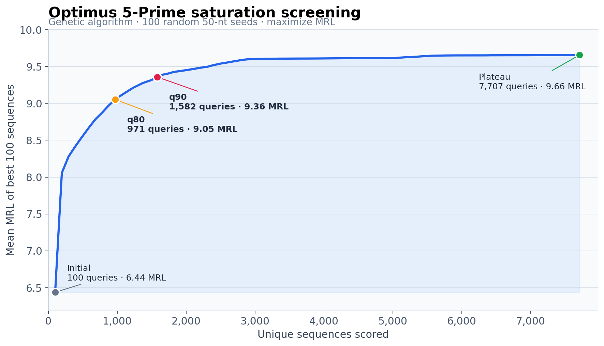

# Biosequence Optimization

Design DNA/RNA sequences with a predictor and an optimization objective.

## Installation

```bash
python -m pip install git+ssh://git@github.com/UTR-CODE/bioseq-optimization.git
```

For pretrained models used in the task guides:

```bash
python -m pip install git+ssh://git@github.com/UTR-CODE/bioseq-models.git
```

## Algorithms

| Algorithm | Function | Predictor interface |
|---|---|---|
| [random](docs/algorithms/random.md) | `random_optimize` | `score` |
| [genetic_algorithm](docs/algorithms/genetic_algorithm.md) | `genetic_algorithm_optimize` | `score` |
| [ism_greedy](docs/algorithms/ism_greedy.md) | `ism_optimize` | `score` |
| [simulated_annealing](docs/algorithms/simulated_annealing.md) | `simulated_annealing_optimize` | `score` |
| [adalead](docs/algorithms/adalead.md) | `adalead_optimize` | `score` |
| [beam_search](docs/algorithms/beam_search.md) | `beam_search_optimize` | `score` |
| [cross_entropy_method](docs/algorithms/cross_entropy_method.md) | `cross_entropy_optimize` | `score` |
| [basesearch](docs/algorithms/basesearch.md) | `basesearch_optimize` | `score` |
| [cbas](docs/algorithms/cbas.md) | `cbas_optimize` | `score` |
| [vanilla_activation_maximization](docs/algorithms/vanilla_activation_maximization.md) | `vanilla_activation_maximization_optimize` | `score_soft` |
| [fast_seqprop](docs/algorithms/fast_seqprop.md) | `fast_seqprop_optimize` | `score_soft` |
| [den](docs/algorithms/den.md) | `den_optimize` | `score_soft` |
| [ledidi](docs/algorithms/ledidi.md) | `ledidi_optimize` | `score_soft` |

[Algorithm and model parameters](docs/algorithms.md).

## 1. Single task: custom CNN

The example weights measure nucleotide composition; use trained weights for a biological task.

```python
import torch
from torch import nn
from sequence_optimization import (
    SequencePredictor,
    genetic_algorithm_optimize,
    random_seed_sequences,
)


class SingleOutputCNN(nn.Module):
    def __init__(self, base="G"):
        super().__init__()
        self.conv = nn.Conv1d(4, 1, kernel_size=1)
        with torch.no_grad():
            self.conv.weight.zero_()
            self.conv.weight[0, "ACGT".index(base), 0] = 1
            self.conv.bias.fill_(-0.25)

    def forward(self, values):
        return self.conv(values).mean(dim=2)


single_model = SequencePredictor(SingleOutputCNN(), device="cpu")
initial = random_seed_sequences(length=20, count=4, seed=7)
single_result = genetic_algorithm_optimize(
    single_model,
    length=20,
    initial=initial,
    objective=["maximize"],
    num_candidates=4,
    budget=1000,
    mutation_rate=0.1,
    elite_fraction=0.5,
    seed=7,
)
print(single_result.to_frame())
```

| sequence | score | activity_task_0 |
|---|---:|---:|
| GCGGGGGGGGGGGGGGGGGG | 0.70 | 0.70 |
| GGAGGCGGCGGGGGGAGGGG | 0.55 | 0.55 |
| GGGAGGAGGGGGTGGGGTGG | 0.55 | 0.55 |
| GGGGGGGGAGGCGGGAAGGG | 0.55 | 0.55 |

A numeric entry sets a minimum raw-output target. A target-only search stops
when one scored sequence reaches the target (or one sequence reaches every
numeric target):

```python
initial = random_seed_sequences(length=20, count=4, seed=7)
target_result = genetic_algorithm_optimize(
    single_model,
    length=20,
    initial=initial,
    objective=[0.60],
    num_candidates=4,
    budget=1000,
    mutation_rate=0.1,
    elite_fraction=0.5,
    seed=7,
)
print(target_result.to_frame())
```

Numeric targets can share a list with directions, for example
`objective=[0.60, "maximize", "ignore"]`. After a numeric target is reached,
later rounds select from candidates at or above that target while continuing
to optimize the remaining `maximize` or `minimize` outputs.

[Optimus: compare optimization algorithms](docs/models/optimus.md).

## 2. Multi-task: custom three-output CNN

One model returns three columns. Here they measure G, C and T composition,
respectively. Raise the first, lower the second and leave the third out of the
optimization objective:

```python
import torch
from torch import nn
from sequence_optimization import (
    SequencePredictor,
    genetic_algorithm_optimize,
    random_seed_sequences,
)


class ThreeOutputCNN(nn.Module):
    def __init__(self):
        super().__init__()
        self.conv = nn.Conv1d(4, 3, kernel_size=1)
        with torch.no_grad():
            self.conv.weight.zero_()
            self.conv.weight[0, 2, 0] = 1
            self.conv.weight[1, 1, 0] = 1
            self.conv.weight[2, 3, 0] = 1
            self.conv.bias.fill_(-0.25)

    def forward(self, values):
        return self.conv(values).mean(dim=2)


multi_model = SequencePredictor(
    ThreeOutputCNN(),
    task_names=["G_activity", "C_activity", "T_activity"],
    device="cpu",
)
initial = random_seed_sequences(length=20, count=4, seed=7)
specific_result = genetic_algorithm_optimize(
    multi_model,
    length=20,
    initial=initial,
    objective=["maximize", "minimize", "ignore"],
    num_candidates=4,
    budget=1000,
    mutation_rate=0.1,
    elite_fraction=0.5,
    seed=7,
)
print(specific_result.to_frame())
```

| sequence | score | G_activity | C_activity | T_activity |
|---|---:|---:|---:|---:|
| AGGGGGGGGGGGGGGGTGGG | 0.45 | 0.65 | -0.25 | -0.20 |
| GGGCGGGGGGGGGTGAAGGG | 0.375 | 0.55 | -0.20 | -0.20 |
| GGGGGCGGGGGGAGGTAGGG | 0.375 | 0.55 | -0.20 | -0.20 |
| GTGGGGGGTGGGGGGGCGAG | 0.375 | 0.55 | -0.20 | -0.15 |

Entries follow output order. `maximize` raises an output, `minimize` lowers it,
and `ignore` excludes it from the objective. Ignored outputs are still reported
in `result.activities`; they are not constrained to remain unchanged.

To raise all three outputs, run a separate search from the same initial sequences:

```python
initial = random_seed_sequences(length=20, count=4, seed=7)
all_high_result = genetic_algorithm_optimize(
    multi_model,
    length=20,
    initial=initial,
    objective=["maximize", "maximize", "maximize"],
    num_candidates=4,
    budget=1000,
    mutation_rate=0.1,
    elite_fraction=0.5,
    seed=7,
)
print(all_high_result.to_frame())
```

| sequence | score | G_activity | C_activity | T_activity |
|---|---:|---:|---:|---:|
| TCGCTCTCCGGGTCTTCTCT | 0.083 | -0.05 | 0.15 | 0.15 |
| TCCCTCGCCGGGGTTCGGCT | 0.083 | 0.10 | 0.15 | 0.00 |
| TCCCTCTCCGGGGCCTGTCG | 0.083 | 0.05 | 0.20 | 0.00 |
| ACCCCCTCCGGGGTTTGGCG | 0.067 | 0.10 | 0.15 | -0.05 |

The default direction-list score is the equal-weight mean of the signed active
outputs. `ignore` outputs are excluded from that mean. Set `model_weights` when
the active outputs should have different influence.

[Multi-task CNN with every optimizer](docs/tasks/multi_task.md) ·
[DeepSTARR: housekeeping specificity](docs/models/deepstarr.md) ·
[Malinois: cell-line specificity](docs/models/malinois.md).

## 3. Multiple independent models: custom CNNs

```python
from sequence_optimization import (
    CombinedScorer,
    SequencePredictor,
    genetic_algorithm_optimize,
    random_seed_sequences,
)

model_a = SequencePredictor(SingleOutputCNN("G"), device="cpu")
model_b = SequencePredictor(SingleOutputCNN("C"), device="cpu")
model_c = SequencePredictor(SingleOutputCNN("T"), device="cpu")
combined = CombinedScorer(
    [model_a, model_b, model_c],
    names=["model_a", "model_b", "model_c"],
)
initial = random_seed_sequences(length=20, count=4, seed=7)
combined_result = genetic_algorithm_optimize(
    combined,
    length=20,
    initial=initial,
    objective=["maximize", "minimize", "minimize"],
    num_candidates=4,
    budget=1000,
    mutation_rate=0.1,
    elite_fraction=0.5,
    seed=7,
)
print(combined_result.to_frame())
print(combined.model_query_counts)
```

| sequence | score | model_a | model_b | model_c |
|---|---:|---:|---:|---:|
| AGGGGGGGGGGGGGGGGGGG | 0.400 | 0.70 | -0.25 | -0.25 |
| GAGGGGGGAGGGGGGAGGAG | 0.350 | 0.55 | -0.25 | -0.25 |
| GAGAGGGGGGGGGAGGAAGG | 0.333 | 0.50 | -0.25 | -0.25 |
| GGGAGGAGGGGGTGGGGTGG | 0.317 | 0.55 | -0.25 | -0.15 |

The query counters for this run are
`{'model_a': 262, 'model_b': 262, 'model_c': 262}`.

`SingleOutputCNN` is defined in the first example. Each model evaluates the same
sequence and returns one output; each can use its own input conversion. The
objective list follows the order in `CombinedScorer`, so this search raises
model A's prediction and lowers B's and C's.

`budget=1000` applies to combined candidate evaluations, not 1000 split between
the models. Each uncached candidate is sent to all three models. The counters
above report cumulative discrete sequence evaluations per model.

Use `objective=["maximize", "maximize", "maximize"]` for an all-high search,
or `ignore` to exclude a model's output from the objective. An ignored model is
still evaluated.

[Independent CNNs with every optimizer](docs/tasks/multiple_models.md) ·
[Agarwal: three cell lines](docs/models/agarwal.md) ·
[DeepSTARR Mouse](docs/models/deepstarr_mouse.md) ·
[DeepSTARR-Embryo](docs/models/deepstarr_embryo.md).

## Set relative model weights

The same `model_weights` parameter applies to a multi-output model and to
independent models joined with `CombinedScorer`. Values follow model-output
order. Active outputs must have positive finite weights; only their ratios
matter. When omitted, every active output has weight 1.

```python
weighted_result = genetic_algorithm_optimize(
    combined,
    length=20,
    initial=initial,
    objective=["maximize", "minimize", "minimize"],
    model_weights=[2.0, 1.0, 1.0],
    num_candidates=4,
    budget=1000,
    mutation_rate=0.1,
    elite_fraction=0.5,
    seed=7,
)
```

This gives `model_a` twice the influence of `model_b` or `model_c`. The scalar
score is the normalized weighted mean
`(2 * model_a - model_b - model_c) / 4`. For a multi-output scorer, use the
same argument with weights ordered by its output columns.

[`MultiTaskObjective` parameters](docs/objectives.md).

## Use your own model

[Wrap your own model](docs/custom_models.md) ·
[Model input requirements](docs/model_input_requirements.md).

## Model tasks

- [Optimize MRL by Optimus 5-Prime](docs/models/optimus.md)
- [Optimize translation output in a 5′UTR, 3′UTR, or CDS by UTR-CODE](docs/models/utr_code.md)
- [Optimize CDS stability by CDS Stability](docs/models/cds_stability.md)
- [Optimize housekeeping enhancer activity and reduce developmental activity by DeepSTARR](docs/models/deepstarr.md)
- [Optimize promoter activity by DREAM LegNet](docs/models/dream_legnet.md)
- [Optimize predicted mRNA stability by Cetnar](docs/models/cetnar_stability.md)
- [Optimize K562 specificity against HepG2 and WTC11 by Agarwal lentiMPRA](docs/models/agarwal.md)
- [Optimize heart specificity across mouse tissues by DeepSTARR Mouse](docs/models/deepstarr_mouse.md)
- [Optimize brain/VNC specificity across embryonic tissues by DeepSTARR-Embryo](docs/models/deepstarr_embryo.md)
- [Optimize K562 enhancer specificity against HepG2 and SK-N-SH by Malinois](docs/models/malinois.md)
- [Jointly optimize RPF and mRNA stability with synonymous codons](docs/tasks/joint_rpf_stability.md)
- [Optimize protein-preserving CDS stability with synonymous codons](docs/tasks/synonymous_cds.md)

## Budget and results

`num_candidates=4` sets the starting population and the number of unique
candidates retained in the result. Each example constructs exactly four unique
starting sequences with `random_seed_sequences`. `budget` defaults to 10,000
counted candidate evaluations, including the initial population; it is not the
number of epochs or the result size. A run may stop before exhausting the budget.

With the default counting mode, the nine discrete optimizers except CbAS count
uncached sequences. CbAS and the four gradient optimizers count repeated
proposals too. `count_repeated=True` selects proposal counting for other methods.
Cache hits can therefore consume budget without another model call.
Gradient evaluations are additional work outside this discrete budget.

`result.sequences` contains the designed strings, `result.scores` the objective,
and `result.activities` all raw predictions, including ignored outputs.

## Sequence constraints

Pass one function or a list of functions through `constraint`. Each function
returns an independent pass probability in `[0, 1]`; only the intersection of
all passing candidates is scored by the model and retained for optimization.

```python
import numpy as np


def gc_at_most_60(sequences):
    return np.asarray([
        (sequence.count("G") + sequence.count("C")) / len(sequence) <= 0.60
        for sequence in sequences
    ], dtype=float)


def excludes_motifs(sequence):
    return float(all(motif not in sequence for motif in ("AAAA", "GGGG")))


initial = random_seed_sequences(length=20, count=4, seed=7)
constrained_result = genetic_algorithm_optimize(
    single_model,
    length=20,
    initial=initial,
    objective=["maximize"],
    constraint=[gc_at_most_60, excludes_motifs],
    num_candidates=4,
    budget=1000,
    seed=7,
)
print(constrained_result.to_frame())
```

[Hard, soft and multiple sequence constraints](docs/constraints.md).

## Saturation screening

Start Optimus 5-Prime from 100 random 50-nt sequences and maximize its MRL
prediction. `SaturationConfig` stops the search after the mean MRL of the best
100 unique sequences levels off. Omit `budget` in this mode; passing both
`budget` and `saturation` raises `ValueError`.

```python
from bioseq_models import load_model

from sequence_optimization import (
    SaturationConfig,
    genetic_algorithm_optimize,
    random_seed_sequences,
)

model = load_model("optimus5prime", device="cpu")
initial = random_seed_sequences(length=50, count=100, seed=7)
saturated = genetic_algorithm_optimize(
    model,
    length=50,
    initial=initial,
    objective=["maximize"],
    num_candidates=100,
    saturation=SaturationConfig(
        fractions=(0.8, 0.9),
        minimum_queries=1_000,
        plateau_patience_queries=2_000,
        maximum_queries=20_000,
        material_improvement=0.01,
    ),
    mutation_rate=0.02,
    elite_fraction=0.2,
    seed=7,
)
q80 = saturated[0.8]
q90 = saturated[0.9]
print(q80.to_frame())
print(q90.to_frame())
print(saturated.stop_reason, saturated.total_query_count)
```

q80 and q90 are the earliest retained candidate sets reaching 80% and 90% of
the improvement from the first complete archive to the final observed archive.
They are not score percentiles or guarantees of reaching the global optimum.
The run must finish before these fractions can be selected. `maximum_queries`
is a safety ceiling; an optimizer can also stop on its own before a plateau is
detected. Check `stop_reason` to distinguish these cases.



In this run, the top-100 mean MRL increases from 6.44 for the initial sequences
to 9.66 at the observed plateau. q80 and q90 select the earliest retained sets
that reach their respective fractions of that gain.

[Initial sequences, budget accounting and saturation parameters](docs/search_workflow.md).
