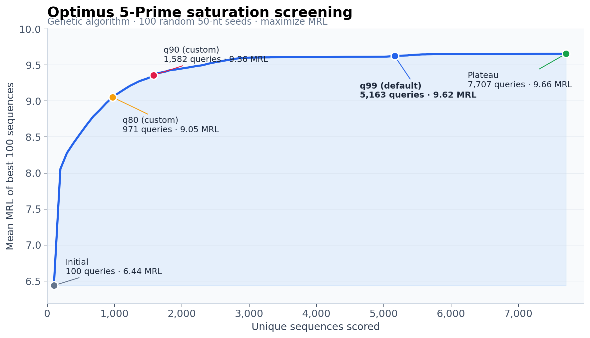

# Advanced Features

Optional arguments to `generate_designs()` for constraining the search space, controlling
the query budget, and shaping multi-task objectives. All of them are optional — the
defaults described in the [README](../README.md) work without any of these settings.

`generate_designs()` exposes `budget`, `saturation`, `fixed_region`,
`is_CDS_optimized`, and `count_repeated` directly. With `budget=None`, non-random
algorithms use plateau stopping and relaxed-knee selection; random search uses
its finite proposal budget because it does not support saturation. Set a positive
`budget` to use the same fixed query limit for every selected algorithm. `budget`
and `saturation` cannot be combined.

## Sequence Constraints

Apply custom constraint functions to filter sequences during optimization. Each constraint
function accepts a **batch** of sequences and returns an array of probabilities (0-1):

- **0**: reject the sequence (it does not enter the next round)
- **1**: accept the sequence
- **0-1**: soft threshold — probability of accepting the sequence

```python
from sequence_optimization import generate_designs, random_seed_sequences
import numpy as np

def gc_soft_threshold(sequences):
    """Soft constraint: prefer 40-60% GC content."""
    gc_contents = np.array([(seq.count('G') + seq.count('C')) / len(seq) for seq in sequences])
    return np.exp(-((gc_contents - 0.5) ** 2) / (2 * 0.1 ** 2))

def exclude_homopolymers(sequences):
    """Hard constraint: reject sequences with 5+ consecutive identical bases."""
    import re
    return np.array([0.0 if re.search(r'([ACGT])\1{4,}', seq) else 1.0 for seq in sequences])

# Combine multiple constraints
result_df = generate_designs(
    model, length=50, initial=initial, objective=["maximize"],
    constraint=[gc_soft_threshold, exclude_homopolymers],
    seed=42,
)
```

See [constraint examples](constraints_examples.md) for ready-made functions covering GC
content, motif exclusion, homopolymer filtering, sequence complexity, RNA secondary
structure, codon usage, and diffusion-model naturalness scoring.

## Fixed Regions

Specify multiple regions to keep unchanged during optimization — useful for preserving
primer binding sites, promoter cores, or linkers. Each entry is a `[start, stop]` interval
with Python slice semantics (`stop` exclusive); negative indices count from the 3' end, and
`None` runs to the end. Bare integers and `"start:stop"` strings are also accepted.

All initial sequences must carry the same bases at the fixed positions, since those
positions become a shared template.

```python
result_df = generate_designs(
    model, length=230, initial=initial, objective=["maximize"],
    fixed_region=[[0, 10], [50, 60], [-20, -1]],  # Preserve positions 0-9, 50-59, 210-229
    seed=42,
)
```

## Diversity Threshold

Control the minimum Hamming distance between candidates returned by each algorithm
(default 5). Higher values give broader exploration, lower values cluster candidates
near the optimum.

```python
result_df = generate_designs(
    model, length=50, initial=initial, objective=["maximize"],
    diversity=10,
    seed=42,
)
```

## Saturation Screening

By default, non-random algorithms stop after a plateau and select a diverse set
around a late relaxed knee. The knee must reach at least 85% of the gain observed
in that run. Selection prefers candidates within 10% of the knee score while
requiring the returned set's mean score to retain at least 80% of observed gain.



These thresholds are computed from the scalarized score trajectory of the current
run. They do not use an MRL cutoff, training-set distribution, or any other
model-specific absolute value.

```python
from sequence_optimization import SaturationConfig

result_df = generate_designs(
    model, length=50, initial=initial, objective=["maximize"],
    algorithms=["genetic_algorithm"],
    saturation=SaturationConfig(fractions=(0.95,), minimum_queries=1000, maximum_queries=50000),
    seed=42,
)
```

## Threshold-Based Multi-Task Optimization

`objective` accepts only `"maximize"`, `"minimize"`, and `"ignore"`.
Supply stopping lines separately with `stop_values`, in model-output order.
Omitting it is equivalent to a list of `None` values (no limits).

For `maximize`, search toward the line while the prediction is below it;
for `minimize`, search toward the line while the prediction is above it.
On reaching or crossing a line, that task stops contributing to further improvement
and becomes a maintained threshold (>= for maximize, <= for minimize).
Other tasks continue. If all non-ignored tasks have lines, search stops when a
single scored sequence satisfies all of them. A `None` task remains open-ended;
an ignored output must have `None`. Raw predictions are not clipped, and a
discrete mutation can overshoot the stopping line. This is not a hard output range.

```python
# K562 high, HepG2 and SKNSH low: stop at directional thresholds.
result_df = generate_designs(
    model, length=200, initial=initial,
    objective=["maximize", "minimize", "minimize"],
    stop_values=[6.0, -2.0, -2.0],
    seed=42,
)
```

## Objective Weights

Set relative importance across tasks (default 1:1).

```python
# Prioritize developmental suppression 2x over housekeeping activation
result_df = generate_designs(
    model, length=249, initial=initial,
    objective=["minimize", "maximize"],
    weights=[2.0, 1.0],
    seed=42,
)
```

## CDS Synonymous Codon Optimization

Restrict mutations to synonymous codon substitutions so the encoded protein is unchanged.
The initial sequences must be in-frame CDS whose length matches `length`.

```python
result_df = generate_designs(
    model, length=300, initial=initial, objective=["maximize"],
    is_CDS_optimized=True,
    seed=42,
)
```

## Fixed Budget Limit

Override saturation screening with a fixed query budget per algorithm.

```python
result_df = generate_designs(
    model, length=50, initial=initial, objective=["maximize"],
    budget=10000,
    seed=42,
)
```

## Custom Model Input Channels

For models with more than 4 input channels (epigenetic marks, conservation scores, RNA
structure), subclass `SequencePredictor` and override the encoding methods — see the
[custom input channels guide](custom_input_channels.md).

## See Also

- [Search workflow](search_workflow.md) — how the query budget and saturation interact
- [Constraint examples](constraints_examples.md) — ready-made constraint functions
- [Custom input channels](custom_input_channels.md) — models beyond 4-channel ACGT
