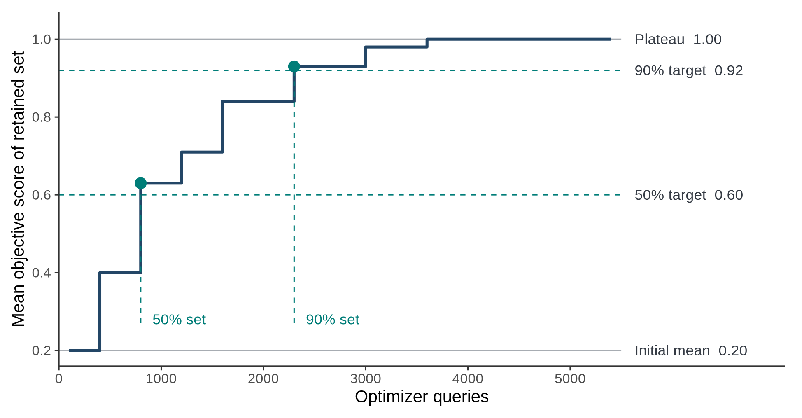

# Choosing a gain fraction

`gain_fractions` selects candidate sets from an optimizer’s search history. Each optimizer records the mean objective score of its retained candidate set as it searches. It runs until the score stops improving materially, then uses the terminal set mean as the observed plateau.



For fraction `f`, the target mean is `initial mean + f × (plateau mean − initial mean)`. In the illustration, the mean rises from 0.20 to 1.00. The targets are 0.60 for `f=0.5` and 0.92 for `f=0.9`. MotifSift returns the earliest saved candidate set that reaches each target.

The illustration shows one optimizer. Each optimizer uses its own baseline and plateau. Request both fractions to retrieve two candidate sets from the same search. The default is 0.9.

```python
from MotifSift import generate_designs

designs = generate_designs(model, length=200, objective="maximize", gain_fractions=(0.5, 0.9))
designs_90 = designs.loc[designs["gain_fraction"].eq(0.9)].copy()
```
