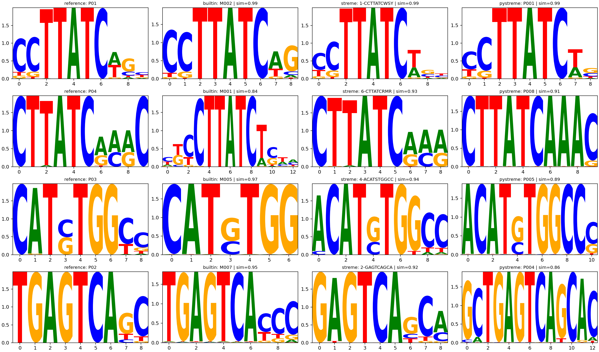

# Built-in discovery, STREME, and pystreme

[Home](../README.md) · [Discovery method](motif-discovery.md) · [Reference files](../examples/data/motif_discovery)

The comparison uses 4,235 contribution-derived seqlets from the K562 enhancer study: 1,072 parent sequences in 176 pre-existing CD-HIT 90% families. This comparison uses sequence-family groups; the normal `call_motifs` default uses parent sequences as its groups. The fixed split contains 3,215 training fragments from 140 families and 1,020 held-out fragments from 36 families. The same families never appear in both sets. Sequences, shuffled controls, and split labels are provided in `examples/data/motif_discovery/seqlets.csv.gz`.

## Discovery and common evaluation

Three discovery runs search widths 6–15 and generate ten candidate PWMs each:

- **Built-in:** canonical k-mer seeds, three seeds per width, ten refinement iterations, training-group presence, and training-only site masking. It directly handles variable-length fragments.
- **STREME:** MEME Suite 5.5.7, the same training foreground and shuffled-control FASTA files, and ten requested motifs. Its internal discovery defaults remain enabled.
- **pystreme:** commit `dd5d3c52a9d7264b50bf43e2457e90a0a46e132a`, PyTorch on an RTX 4090, three seeds per width and ten refinement iterations. Variable-length seqlets are right-padded with invalid `N` bases, which cannot enter scanned windows. Internal hold-out is disabled because the comparison uses the external family-held-out split. Its discovery background is order 0.

Every candidate is independently evaluated through the same scanner and statistical procedure. Estimate a strand-symmetric order-0 background from the training controls, calibrate each PWM's threshold on the original training families, and evaluate the fixed threshold on held-out families. A paired exact binomial test counts foreground-only and control-only families. Bonferroni correction covers all 30 candidate hypotheses jointly. Retention additionally requires ten supporting seqlets and three unique parents.

| Method | Discovery candidates | Passing the common validation |
|---|---:|---:|
| Built-in | 10 | 5 |
| STREME | 10 | 2 |
| pystreme | 10 | 5 |

These are retained PWM variants, not counts of distinct transcription factors. Their number does not establish which method is better. The built-in support table also provides its native correction across its own ten candidates, separately from this joint comparison.

## Recovery of the previous four motif patterns

For each previous reference PWM, the table reports its best full-span, information-weighted PWM similarity across strands and shifts. Informative flanks enter the similarity normalization. Reference matching examines all ten discovery candidates, including those that do not pass held-out validation.

| Reference pattern | Built-in | STREME | pystreme |
|---|---:|---:|---:|
| P01: major GATA pattern | 0.993 | 0.988 | 0.989 |
| P04: GATA flank variant | 0.836 | 0.929 | 0.912 |
| P03: CATGTGG-like pattern | 0.971 | 0.937 | 0.888 |
| P02: AP-1-like pattern | 0.949 | 0.919 | 0.856 |

Best-matching logos are oriented to the reference strand.



All methods find candidates resembling the previous cores, with differences in motif length and flanks. In this comparison, the best CATGTGG-like and AP-1-like matches do not pass the common family-held-out gate. Motif similarity and independent enrichment are reported separately.

## Effect on candidate panels

Each method's commonly validated catalog was scanned by FIMO against the same 1,100 candidate records. The existing motif composition/position selector chose ten designs with specificity score ≥ 20.

| Panel pair | Identical DNA shared among the Top10 |
|---|---:|
| Built-in / STREME | 1 |
| Built-in / pystreme | 1 |
| STREME / pystreme | 3 |

Thus, similar motif cores do not imply interchangeable final panels. PWM flanks, catalog composition, scan significance, and Max-Min selection all affect which sequences are selected. The selected DNA, scores, motif combinations, and provenance are included in the three `*_top10.csv` reference files. These results establish that the built-in backend integrates with the panel workflow; experimental performance of the selected sequences remains a separate question.

## Runtime and checks

The initial recorded discovery calls took approximately 1.4 seconds for the built-in CPU method, 3.9 seconds for STREME, and 6.5 seconds for pystreme on GPU. These single-run wall times include different initialization costs and are provided as workflow timings rather than a general speed ranking.

Additional checks:

- 40 independent random-background datasets: 20 uniform and 20 GC-rich, with 160 variable-length fragments each. No dataset yielded a retained motif. This is a small null diagnostic, not a comprehensive calibration study.
- Planted-motif recovery, reverse-complement scanning, invalid padding, preservation of dinucleotide counts, and isolation of training from held-out sequences.
- 79 upstream pystreme scanner/statistics/seed/refinement tests passed on CPU; this is the examined subset, not the complete upstream suite.
- Contribution arrays → tangermeme seqlets → built-in discovery → MEME export → FIMO scanning → candidate selection completed successfully without STREME available to the discovery call.

## Reproduce discovery and common validation

With the repository's analysis and motif dependencies installed:

```bash
git clone https://github.com/vmindel/pystreme.git /tmp/pystreme
cd /tmp/pystreme
git checkout dd5d3c52a9d7264b50bf43e2457e90a0a46e132a
```

From the optimization repository, use a new output directory:

```bash
python tools/compare_motif_discovery.py \
  --methods builtin streme pystreme \
  --pystreme-source /tmp/pystreme \
  --output-dir outputs/discovery_comparison
```

STREME must be on `PATH`, or supplied with `--streme /path/to/streme`. The built-in method alone requires neither pystreme nor STREME:

```bash
python tools/compare_motif_discovery.py \
  --methods builtin \
  --output-dir outputs/builtin_comparison
```

The joint p-value correction uses the number of candidates actually compared, so a built-in-only evaluation has a different correction from the three-method comparison. Per-method PWM files, support, runtimes, and common validation results are exported. The reference files include manifests, discovery matrices, the common validation, the small null diagnostic, and panel-overlap counts. `manifest.json` records the null diagnostic's sequence distributions, length range, random seeds, and discovery settings.
